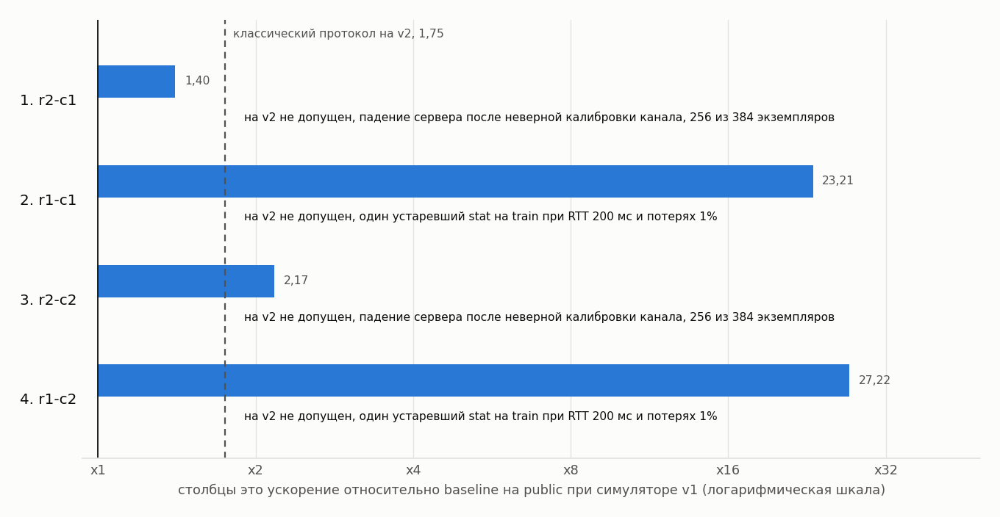

# Разбор эволюции

Основная кампания еще впереди. Здесь пока разбор проверочной кампании на Opus от 06.11.2026. Ее цель в том, чтобы проверить сам кейс. Понимает ли исследователь интерфейс, ловит ли метрика его ошибки, есть ли куда расти.

## Проверочная кампания

Условия в [campaign.md](../case/campaign/campaign.md). Два исследователя в отдельных копиях репозитория, лимит 4 решения на кампанию, по 2 на исследователя. Исследователь r1 получил направление «путь чтения», r2 получил «запись и трафик». Исследователи видели train целиком и не видели классический протокол. Public считал я как оператор после каждого кандидата, private не трогал.

Журнал в [journal.jsonl](../results/validation-opus/journal.jsonl), снимки кандидатов в [candidates/](../results/validation-opus/candidates), заметки исследователей лежат рядом с кодом в `NOTES.md`.

| Порядок | Кандидат | Родитель | Идея | Public v1 | Public v2 | Допущен на v2 |
|---|---|---|---|---|---|---|
| 1 | r2-c1 | baseline | запись подтверждается до ответа сервера по откалиброванной модели канала, сжатие, двоичная рамка | 1,40 | 0 | нет, падает на 256 из 384 |
| 2 | r1-c1 | baseline | реплика дерева, кэш блоков, аренда свежести, фоновый поток с первой паузы, словарь строк | 23,21 | 2,20 | нет, один устаревший stat |
| 3 | r2-c2 | r2-c1 | stat сразу несет начало файла, чтение с опережением, кэш на T от чтения сервером | 2,17 | 0 | нет, падает на 256 из 384 |
| 4 | r1-c2 | r1-c1 | режим фонового потока по поведению агента, края больших файлов заранее | 27,22 | 2,19 | нет, один устаревший stat |

Классический протокол для сравнения дает 1,72 на train v2 и 1,75 на public v2.

Кривая по public v1 идет 1,40, 23,21, 23,21, 27,22, AUC на горизонте 4 равна 48,8. На v2 ни один кандидат не допущен, и кривая остается на baseline. Картинка кривой v1 лежит в `results/figures/curve_validation_v1.png`.

### Что нашла кампания

Главная находка в том, что арена нашла три дыры в моей постановке раньше, чем хорошие протоколы.

Первая дыра. Сеть в v1 была детерминирована. Исследователь r2 откалибровал канал четырьмя пробами, восстановил модель доставки с точностью до микросекунд и подтверждал запись агенту ровно с таким запасом, чтобы она дошла до пользователя за 1 с. В настоящей сети время доставки так не предсказать.

Вторая дыра. Часы клиента и сервера в v1 совпадали. Оба исследователя независимо пришли к меткам времени сервера, которые клиент сравнивал со своими часами. У r2 на этом держалась калибровка канала, у r1 аренда свежести кэша.

Третья дыра. Генератор v1 собирал текст всех файлов из общего пула строк. Исследователь r1 заметил это и придумал словарь строк, который сжимал текст в 10-14 раз против 3,3 у zlib. На настоящем коде такой словарь дает 1,1-2,0 раза. Этот прием дал большую часть ускорения в 23-27 раз.

Все три дыры закрыты в симуляторе v2 ([ADR-0007](adr/0007-jitter-and-clocks.md), [ADR-0008](adr/0008-text-realism.md)). На v2 кандидаты r2 падают сразу, потому что их калибровка канала разваливается. Кандидаты r1 работают и дают около 2,2 на public, то есть их настоящие идеи (реплика дерева, фоновый поток в паузах, края больших файлов) дают примерно на 25% больше классического протокола. Но у обоих на train v2 есть одно нарушение. Это устаревший stat после правки пользователя при RTT 200 мс и потерях 1%, аренда свежести не учла джиттер. По правилам такой кандидат в финалисты не идет.

### Идеи, которые стоит дать основной кампании

Реплика дерева и фоновый поток содержимого в паузах LLM работают и на v2. У r1-c2 на train v2 grep ускоряется в 4,7 раза, обход дерева в 10,4 раза, у классического протокола 1,6 и 8,0.

Начало и конец больших файлов, отправленные заранее, убирают первый круг к большому файлу. На v2 это дает 1,15 на сценарии большого файла против 1,07 у r1-c1.

Слить stat с первым чтением файла выгодно на любом RTT, если агент обычно читает файл после stat.

Запись осталась главным резервом. На v1 r2 ускорял записи в 2,6-4,2 раза, но держался на точной модели канала. На v2 ни один работающий кандидат записи не ускорил, а r1 замедлил их до 0,75, потому что фоновый поток занимает канал. Write-back с запасом на джиттер и паузой фона на время записи это первое, что стоит проверить в основной кампании.

### Что это говорит о методе

Арена оптимизирует букву метрики. Если в симуляторе есть упрощение, которого нет в задаче, исследователь его найдет и построит на нем решение. Поэтому до основной кампании постановку нужно проверить дешевым прогоном, а гейты делать такими, чтобы прием, работающий только в симуляторе, ломал корректность, а не просто терял баллы. Джиттер и разные часы делают именно это.

## Кривая и AUC

Будет по журналу основной кампании, скрипт `scripts/curve.py`.

## Родословная

Будет по журналу основной кампании.

## Сопоставление с доменом

Будет после основной кампании.

## Переобучение

| Кандидат | Train | Public | Private |
|---|---|---|---|
| baseline (v2) | 0,99 | 0,99 | |
| классический (v2) | 1,72 | 1,75 | |
| r1-c2 (v1) | 28,13 | 27,22 | не оценивался |

## Что я понял о задаче

Будет после основной кампании.
